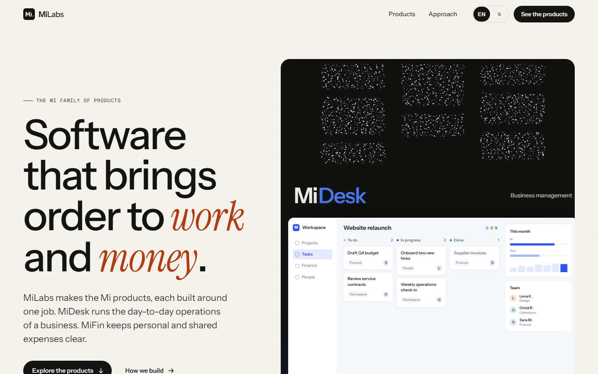
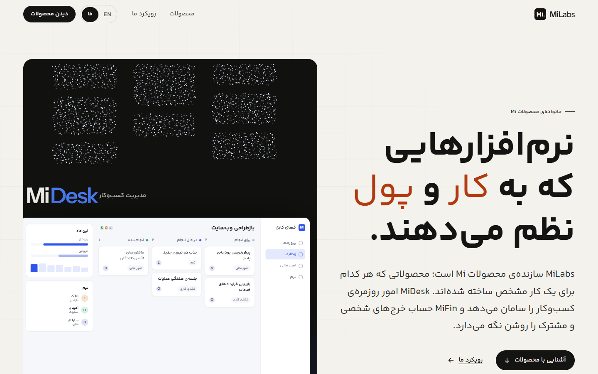
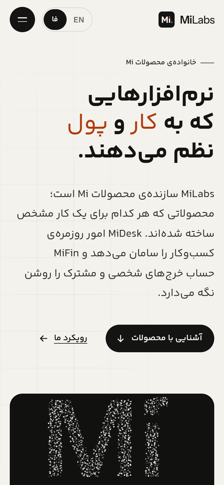
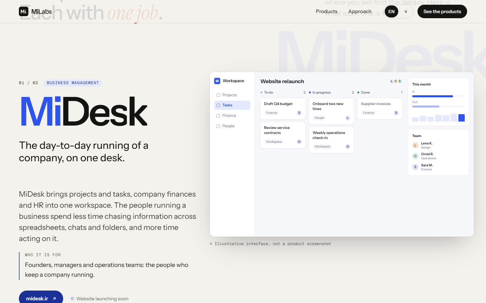
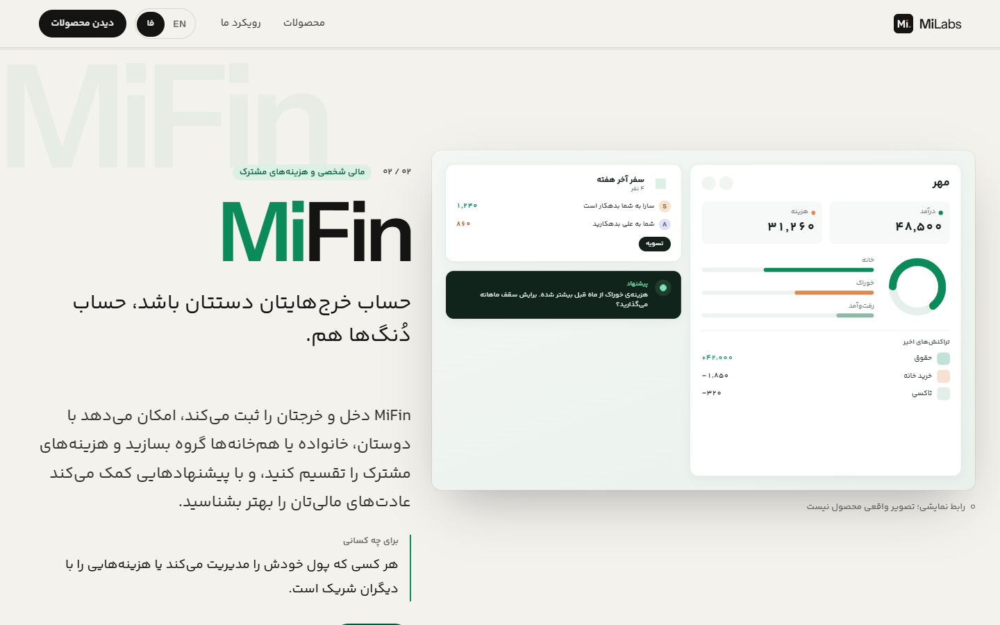
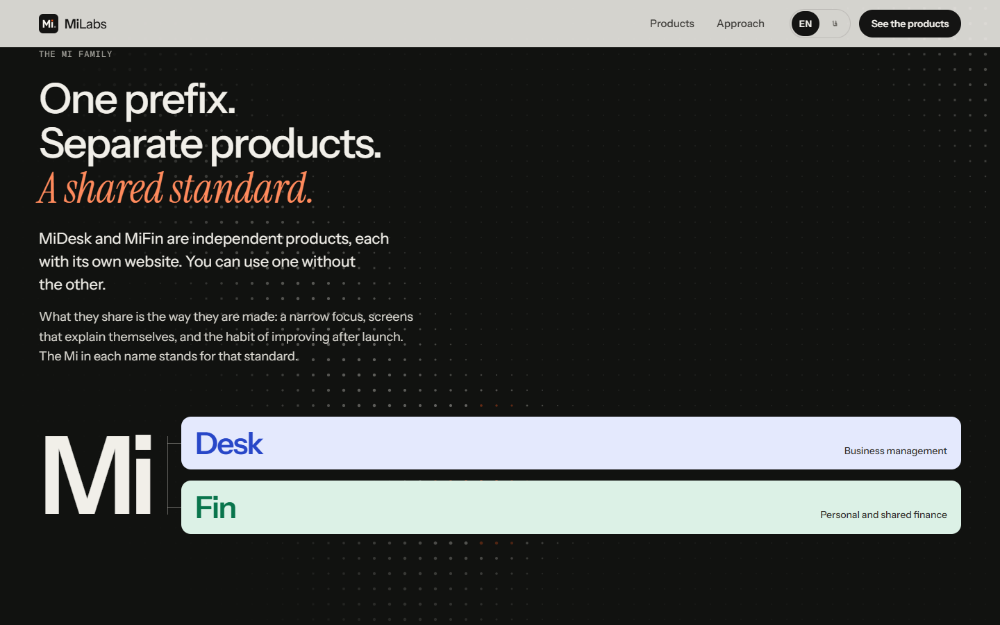
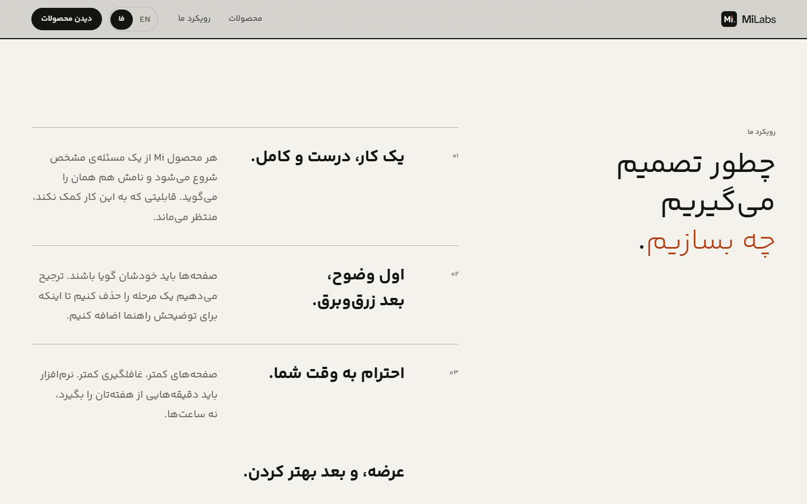
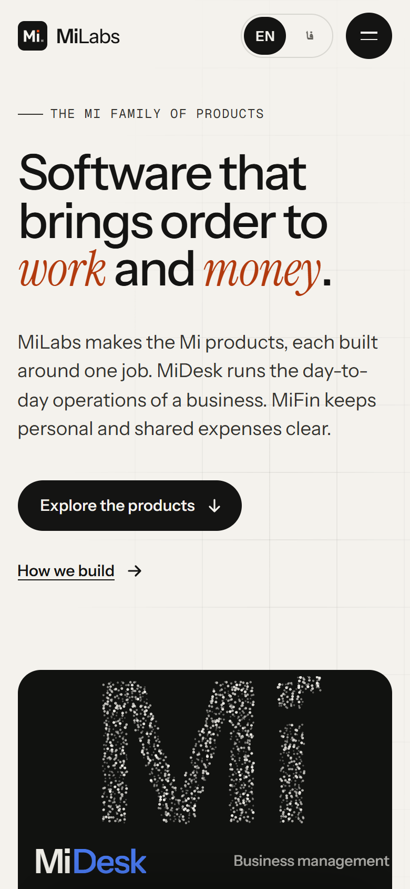
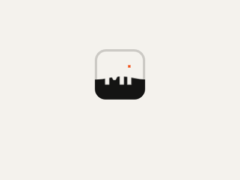

<div align="center">


# MiLabs

**Software that brings order to work and money.**

The bilingual brand website for MiLabs and the Mi family of products: **MiDesk** and **MiFin**.

English · فارسی · [milabs.ir](https://milabs.ir/)


</div>

<br>



<br>

## Overview

MiLabs is the parent brand for a family of focused products. This site introduces the family and sends visitors to each product's own website.

| Product | What it does | Website |
| --- | --- | --- |
| **MiDesk** | Business management: projects and tasks, company finances, HR | [midesk.ir](https://midesk.ir/) |
| **MiFin** | Personal finance: income and expenses, shared groups, settlements, suggestions | [mifin.ir](https://mifin.ir/) |

Both languages are first-class: Persian is a true right-to-left layout with its own typography, not a mirrored copy of the English page.

| Persian (RTL) | Mobile |
| --- | --- |
|  |  |

## Screenshots

<table>
  <tr>
    <td width="50%"><br><sub><b>Product chapter.</b> The picture assembles tile by tile; the name rolls in letter by letter.</sub></td>
    <td width="50%"><br><sub><b>Persian layout.</b> RTL grid, Yekan Bakh, Persian digits in the interface.</sub></td>
  </tr>
  <tr>
    <td width="50%"><br><sub><b>One prefix, separate products.</b> A dot-matrix wave that reacts to the cursor.</sub></td>
    <td width="50%"><br><sub><b>Approach.</b> A bar sweeps across each principle in reading direction to reveal it.</sub></td>
  </tr>
  <tr>
    <td width="50%"><br><sub><b>Mobile.</b> Particles scale down in count; the layout is rebuilt, not shrunk.</sub></td>
    <td width="50%" align="center"><br><sub><b>First load.</b> The MiLabs symbol fills as the page actually becomes ready.</sub></td>
  </tr>
</table>

## Features

- **Bilingual, crawlable URLs:** `/en/` and `/fa/`, with `/` as a language entry page (no forced redirect). Includes canonical and `hreflang` links (with `x-default`), a sitemap, Open Graph images per language, and JSON-LD.
- **Real RTL:** logical CSS properties throughout, and a separate Persian type scale and line height. Directional motion follows reading direction; product names, logos and interface previews are deliberately not mirrored.
- **Motion system:**
  - Hero particles (raw WebGL, no Three.js) gather from scattered dots into "Mi", then into each product's shape.
  - Product names roll in like a slot machine, and product pictures reveal tile by tile.
  - CTA buttons fill like liquid, with a slight magnetic pull toward the cursor.
  - A dot-matrix wave sits behind the family section, a cursor light passes over the footer wordmark, and the page loader is the logo filling up.
- **Respectful motion:** everything is disabled under `prefers-reduced-motion`. Content is fully visible without JavaScript, canvases pause off-screen and in background tabs, and GSAP loads only after first render.
- **Live product demos:** each product can open its live demo in an in-page dialog (iframe), enabled per product once a public demo exists. See [CONTENT_ASSET_GUIDE.md](CONTENT_ASSET_GUIDE.md#6-enabling-the-live-demo-iframe).
- **Data-driven products:** adding a Mi product is one entry in `app/data/products.ts`. It appears in the hero, chapters, family diagram, closing list, footer and structured data.
- **No trackers, no third-party requests:** fonts are self-hosted and no analytics are included.

## Tech stack

| | |
| --- | --- |
| Framework | [Nuxt 4](https://nuxt.com/) · Vue 3 · TypeScript (strict) |
| i18n | [@nuxtjs/i18n](https://i18n.nuxtjs.org/) (prefix strategy, lazy-loaded locale files) |
| Motion | [GSAP](https://gsap.com/) + ScrollTrigger, CSS, WebGL, Canvas 2D |
| Fonts | Instrument Sans, Instrument Serif, Geist Mono (OFL) · Yekan Bakh (commercial, Persian) |
| Output | Static site (`nuxt generate`) |
| QA | Playwright (custom browser checks), Lighthouse |

## Getting started

Requires **Node.js 20+** (developed on Node 24).

```bash
npm install
npm run dev          # http://localhost:3000/en/
```

### Scripts

| Command | What it does |
| --- | --- |
| `npm run dev` | Development server |
| `npm run generate` | Static production build into `.output/public` |
| `npm run preview` | Preview the production build |
| `npm run typecheck` | TypeScript and Vue template checks |
| `npm run check:locales` | Verifies `en.json` and `fa.json` have identical, non-empty keys |
| `npm run qa` | Browser QA on the static build: both languages at 6 widths plus reduced motion; checks console errors, overflow, hidden content, links, the language switch, the mobile menu and the loader |
| `npm run screenshots` | Regenerates the images in `docs/screenshots/` |
| `npm run assets:brand` | Regenerates the favicon, app icons and Open Graph images |

`qa`, `screenshots` and `assets:brand` use a locally installed Chrome or Edge, or Playwright's Chromium (`npx playwright install chromium`).

## Project structure

```
app/
  assets/css/        fonts.css · tokens.css (design tokens, RTL overrides) · base.css
  components/
    layout/          SiteHeader, SiteFooter, LanguageSwitcher, PageLoader
    sections/        Hero, Products, Ecosystem, Approach, Closing
    products/        ProductChapter, ProductVisual, ProductDemo, placeholders/
    ui/              ParticleStage, SlotText, PixelReveal, DotWave, BrandLoader, ActionLink …
  composables/       useMotion (scoped GSAP + matchMedia + cleanup), useSiteSeo
  data/              products.ts · site.ts · motion.ts · entry.ts
  utils/             particle-field.ts (WebGL), particle-shapes.ts, page-ready.ts …
  pages/             index.vue (language entry "/") · home.vue (/en/, /fa/)
i18n/locales/        en.json · fa.json
server/routes/       sitemap.xml.ts
public/              fonts/ · brand/ · og/ · images/products/placeholders/
scripts/             qa · screenshots · check-locales · generate-brand-assets
docs/screenshots/    README images
```

## Content and assets

Copy lives in `i18n/locales/` and `app/data/products.ts`, never in components. The product interface images are currently **coded placeholder illustrations**, labelled on the page as "not a product screenshot". [CONTENT_ASSET_GUIDE.md](CONTENT_ASSET_GUIDE.md) covers how to:

- swap in real screenshots (fixed 16:10 frame, so the layout and animations do not change)
- enable live demos
- add a new Mi product
- update links, SEO metadata and fonts

## Deployment

Upload `.output/public` to any static host. Recommended headers:

| Path | Cache-Control |
| --- | --- |
| `/_nuxt/*`, `/fonts/*` | `public, max-age=31536000, immutable` |
| HTML | `no-cache` |

## Fonts and licensing

- **Instrument Sans, Instrument Serif, Geist Mono:** SIL Open Font License 1.1.
- **Yekan Bakh** (Persian): a commercial font by Reza Bakhtiarifard, distributed by [fontiran.com](https://fontiran.com/). Its files are in `public/fonts/` for this site only. **Do not reuse them** in other projects without your own license, and confirm the web license covers milabs.ir before publishing.

<div align="center">
<br>
<sub>© MiLabs. All rights reserved.</sub>
</div>
